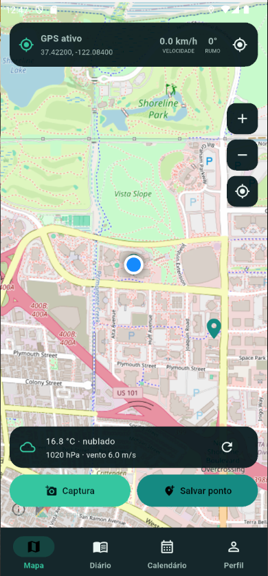
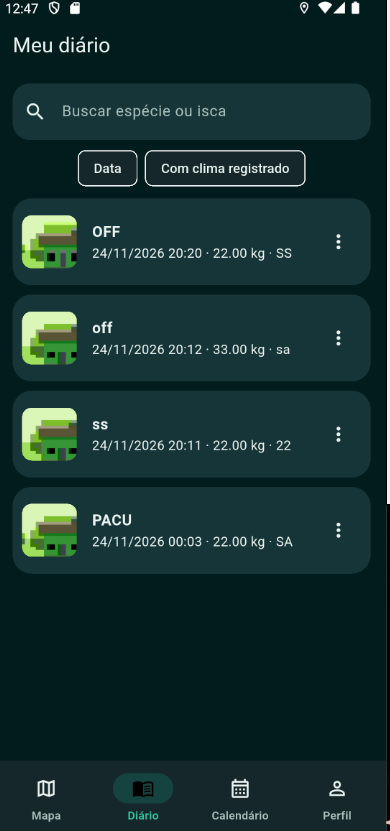
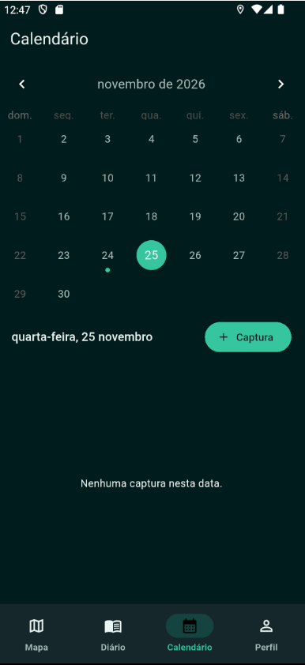
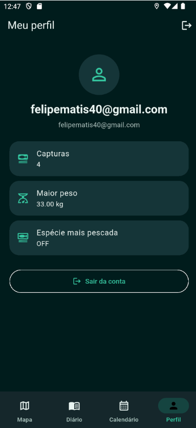

# MyFish

Aplicativo Flutter para pescadores amadores registrarem capturas, condições do tempo e pontos de pesca em um mapa.

Desenvolvido por: Felipe Matis de Almeida

## Funcionalidades

- Cadastro, login, recuperação de senha e perfil com estatísticas de capturas.
- Registro, edição e exclusão de capturas, com espécie, medidas, isca, equipamento, modalidade, observações, foto, localização e clima.
- Registro de pontos de pesca com nome, tipo, descrição e privacidade.
- Mapa OpenStreetMap com GPS, capturas e pontos públicos ou do próprio usuário.
- Diário cronológico com filtros e calendário de capturas.
- Persistência local em SQLite; alterações offline ficam na fila até a conexão retornar.
- Sincronização com Cloud Firestore usando IDs estáveis, sem duplicar registros após uma nova tentativa.

## Capturas de tela

| Mapa | Diário |
| --- | --- |
|  |  |

| Calendário | Perfil |
| --- | --- |
|  |  |

| Login | Cadastro |
| --- | --- |
|  |  |

## Tecnologias

| Tecnologia | Uso |
| --- | --- |
| Flutter e Dart | Aplicativo Android e iOS |
| Firebase Authentication | Conta por e-mail/senha e Google |
| Cloud Firestore | Capturas, pontos e dados dos usuários |
| SQLite (`sqflite`) | Cache local e fila persistente de sincronização |
| OpenStreetMap (`flutter_map`) | Mapa sem chave do Google Maps |
| Geolocator | Localização GPS |
| OpenWeatherMap | Dados meteorológicos por coordenada |
| Image Picker e `image` | Seleção, compressão e codificação das fotos |
| `table_calendar` | Calendário com eventos de captura |

## Estrutura principal

```text
lib/
  config/        configuração e integrações externas
  models/        modelos tipados e conversão de dados
  repositories/  acesso ao Firestore e sincronização offline
  services/      SQLite, GPS, clima e tratamento de fotos
  theme/         identidade visual e tema Material
  view/          telas, mapa, diário, calendário e formulários
  viewmodels/    estado e lógica de apresentação
test/            testes de modelos, fotos e banco local
```

## Configuração

1. Instale Flutter e Android Studio com um emulador Android configurado.
2. Crie `.env` a partir de `.env.example` e informe sua chave:

   ```text
   OPENWEATHERMAP_API_KEY=sua_chave_openweathermap
   ```

3. Configure um projeto Firebase com Authentication e Cloud Firestore. Confira `lib/firebase_options.dart` e os arquivos nativos Firebase para os seus aplicativos.
   - **Google no Android:** habilite o provedor Google no Firebase Authentication, cadastre o SHA-1 do app (`.\gradlew.bat signingReport` dentro de `android`) e baixe novamente `android/app/google-services.json`. O arquivo precisa incluir um cliente OAuth da Web.
   - **Apple:** configure e habilite o provedor Apple no Firebase com as credenciais do Apple Developer. O botão Apple já chama esse provedor; para testar alterações recentes, reinstale o app com `flutter run`.
4. Publique as regras do Firestore:

   ```powershell
   firebase deploy --only firestore:rules
   ```

5. Habilite localização e câmera conforme necessário no emulador/dispositivo. Para testar o GPS do emulador, use **Extended controls → Location**.

O mapa usa OpenStreetMap e apresenta a atribuição aos contribuidores. As fotos são comprimidas e armazenadas em Base64 em documentos separados da coleção `catchPhotos`; isso evita carregar imagens nas consultas do mapa, mas ainda consome as cotas do Firestore. A chave do OpenWeatherMap incluída no aplicativo pode ser extraída do APK; não a trate como segredo de produção.

## Executar e validar

```powershell
flutter pub get
flutter emulators --launch Medium_Phone
flutter run
```

```powershell
dart analyze lib test
flutter test
flutter build apk
```

Para regenerar os recursos de identidade nativos após alterar a imagem ou as cores:

```powershell
flutter pub run flutter_launcher_icons
flutter pub run flutter_native_splash:create
```